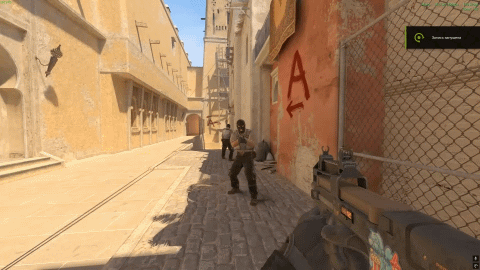

[<kbd><br>🇷🇺 Russian README<br><br></kbd>](./README_RU.md)

# Fortnite Damage
Displays damage numbers above the victim in Fortnite style  
The numbers are visible to the attacker and players spectating them  
Damage display is enabled by default, each player can disable it with a command and their choice is saved  
The particles for the plugin were created by [kolkazadrot](https://kolkazadrot.ru/)

# Preview


# Commands
css_hits - Enable/disable damage display  
css_fh - Enable/disable damage display  
css_fortnite_hits - Enable/disable damage display

# Config
```jsonc
{
    "Distance": 40.0, // Distance between the victim and damage numbers
    "Commands": ["css_hits", "css_fh", "css_fortnite_hits"], // Commands to enable/disable damage display
    "ConfigVersion": 1 // Config version
}
```

# Installation
Install [Metamod:Source](https://www.sourcemm.net/downloads.php?branch=dev), [CounterStrikeSharp](https://github.com/roflmuffin/CounterStrikeSharp/releases) version 1.0.372 or newer and [MultiAddonManager](https://github.com/Source2ZE/MultiAddonManager/releases)\
Copy the addons folder from the archive to /game/csgo  
Download the workshop_fortnite_dmg.zip resource archive, upload its contents to the server preserving their paths and include them in the Workshop content downloaded by players, or add the dedicated addon with ID 3330726239
Edit the config file to suit your needs  
Restart the server or force-load the plugin using the command css_plugins load
