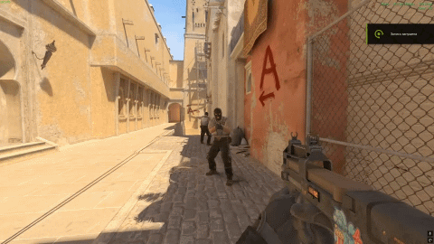

[<kbd><br>en English README<br><br></kbd>](./README.md)

# Fortnite Damage
Отображение цифр урона над жертвой в стиле Fortnite  
Цифры видит атакующий и игроки которые за ним наблюдают  
Показ урона включён по умолчанию, каждый игрок может отключить его командой, выбор сохраняется  
Партиклы для работы плагина сделаны [kolkazadrot](https://kolkazadrot.ru/)

# Превью


# Команды
css_hits - Включить/выключить показ урона  
css_fh - Включить/выключить показ урона  
css_fortnite_hits - Включить/выключить показ урона

# Конфиг
```jsonc
{
    "Distance": 40.0, // Расстояние между жертвой и цифрами урона
    "Commands": ["css_hits", "css_fh", "css_fortnite_hits"], // Команды для включения/выключения показа урона
    "ConfigVersion": 1 // Версия конфига
}
```

# Установка
Установить [Metamod:Source](https://www.sourcemm.net/downloads.php?branch=dev), [CounterStrikeSharp](https://github.com/roflmuffin/CounterStrikeSharp/releases) версии 1.0.372 или новее и [MultiAddonManager](https://github.com/Source2ZE/MultiAddonManager/releases)\
Скопировать папку addons из архива в /game/csgo  
Скачать архив workshop_fortnite_dmg.zip с ресурсами, загрузить их на сервер с сохранением путей и добавить их в Workshop-контент который скачивают игроки или подключите специальный аддон под айди 3330726239
Отредактировать конфиг под себя  
Перезапустить сервер или принудительно загрузить плагин с помощью команды css_plugins load
